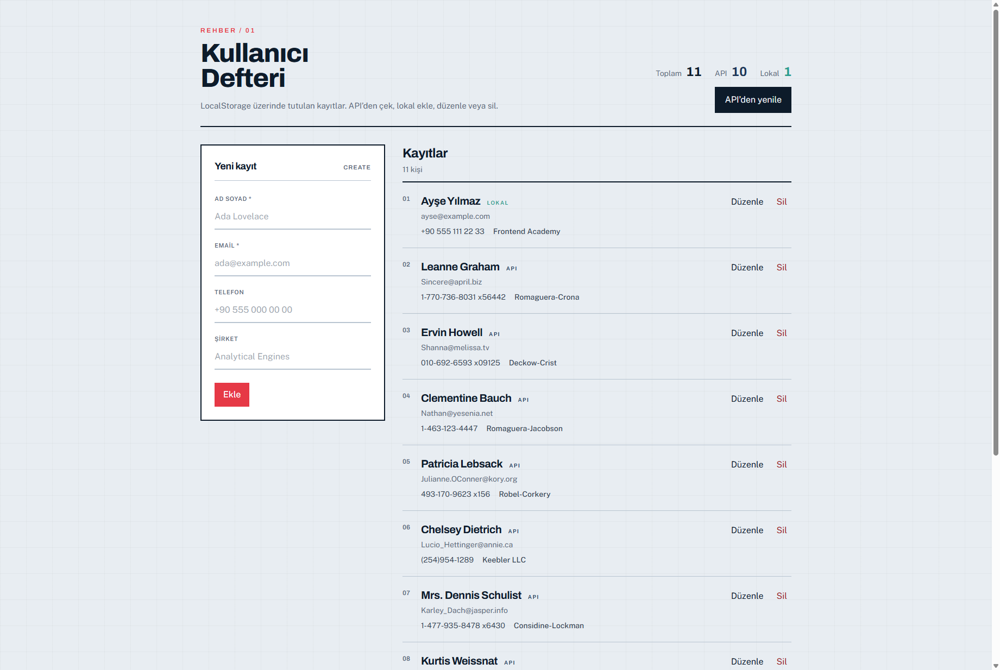

# Kullanıcı Defteri

Vite + React + TypeScript + Tailwind CSS ile geliştirilmiş kullanıcı yönetimi uygulaması.

JSONPlaceholder API, LocalStorage kalıcılığı ve tam CRUD (Ekle / Listele / Güncelle / Sil) işlemlerini içerir.

## Ekran Görüntüsü



## Mimari

Katmanlı yapı; UI iş mantığından ayrılmıştır.

```
src/
  interfaces/     # Domain tipleri (User)
  constants/      # Storage key, API URL
  services/       # LocalStorage + API erişimi
  hooks/          # useUsers — CRUD state & aksiyonlar
  components/     # Sunum bileşenleri
  pages/          # Sayfa kompozisyonu
```

| Katman | Sorumluluk |
|--------|------------|
| `interfaces` | Tip tanımları |
| `services` | Veri kaynakları (storage / HTTP) |
| `hooks` | State, CRUD, istatistik |
| `components` | Form, liste, istatistik UI |
| `pages` | Layout ve bağlantı |

## Özellikler

- **Ekle:** Form ile yeni kullanıcı
- **Listele:** Satırlı kayıt listesi
- **Güncelle:** Düzenle → kaydet
- **Sil:** Onaylı silme
- **API yenile:** JSONPlaceholder seed + LocalStorage sıfırlama

## Teknolojiler

- React 19 · TypeScript · Vite
- Tailwind CSS v4 · Framer Motion
- LocalStorage · JSONPlaceholder

## Kurulum

```bash
npm install
npm run dev
```

## Build

```bash
npm run build
npm run preview
```

## Netlify

`netlify.toml` ayarları:

- Build: `npm run build`
- Publish: `dist`

## Linkler

- **GitHub:** https://github.com/Utkkku/kullanici-defteri
- **Canlı (Netlify):** https://kullanici-defteri.netlify.app

## Teslim Checklist

- [x] React + Tailwind CRUD
- [x] Components / Pages / Interfaces (+ services / hooks)
- [x] Ekle, Listele, Güncelle, Sil
- [x] Ekran görüntüsü
- [x] GitHub public repo
- [x] Netlify canlı link
